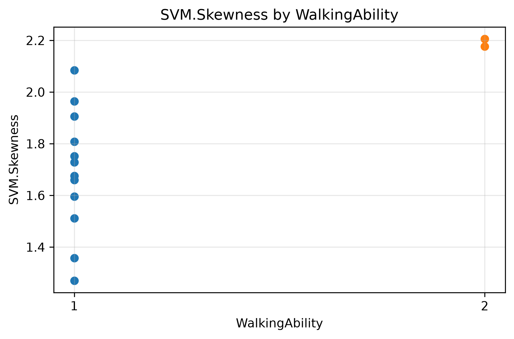
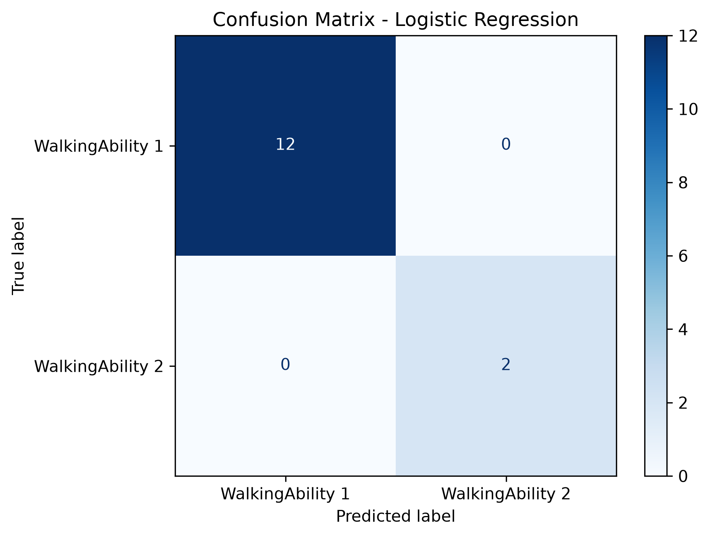

# 鶏の加速度センサデータを用いた歩行能力分析
## 1. 背景

肉用鶏（ブロイラー）において、歩行能力の低下は重要なアニマルウェルフェア上の課題の一つである。
歩行障害は鶏の移動を制限し、餌や水へのアクセスや行動にも影響する可能性がある。

歩行能力の評価には、人が鶏の歩行状態を観察して評価するGait Scoreなどの手法が用いられている。
しかし、人による評価には時間や労力が必要であり、多数の個体を継続的に観察することは難しい。

そこで、加速度センサなどを利用して鶏の行動を継続的・客観的に把握する手法が研究されている。
加速度データから歩行能力の変化に関連する特徴を捉えることができれば、多数の鶏の中から歩行能力が低下している可能性のある個体を把握し、飼育者が優先的に確認する仕組みへの活用が考えられる。
これにより、人による観察を補助して確認作業を効率化するとともに、歩行状態の変化を早期に把握し、鶏の健康管理やアニマルウェルフェア向上につなげられる可能性がある。

特に、多数の鶏の中から歩行能力が低下している可能性のある個体を抽出し、飼育者が優先的に確認する仕組みとして活用できれば、観察作業の効率化や異常の早期発見につながる可能性がある。


## 2. 目的

本分析では、鶏に装着された加速度センサから得られたデータを用いて、
歩行能力（WalkingAbility）の違いに関連する特徴量を探索する。

さらに、抽出した特徴量を用いて機械学習モデルを構築し、
WalkingAbilityを分類できる可能性を検証する。

最終的には、加速度センサを活用して歩行能力低下の可能性がある個体を検知し、飼育者が確認すべき個体を絞り込むなど、鶏の健康・福祉状態を効率的にモニタリングする仕組みへの応用可能性を考察する。

## 3. 使用データ
### データ概要
本分析では、鶏に装着された加速度センサから取得されたデータを使用した。

元データは2,497行・120列で構成されており、7個体の鶏のデータが含まれている。
加速度センサから算出された特徴量のほか、個体情報や歩行能力などの評価項目が含まれている。
※ 使用データの再配布条件を考慮し、本リポジトリには元データおよび加工済みデータを含めていない。

### 主な項目
- WalkingAbility：鶏の歩行能力を示す評価指標。本分析では目的変数として使用
- Age_Days：日齢
- SexFM：性別
- Weightkg：体重
- Pododermatitis：趾蹠皮膚炎に関する指標
- HockBurn：飛節部の皮膚損傷に関する指標
- Feathercover：羽毛状態に関する指標
- 加速度センサ由来の各種特徴量
  
### データ出典
本分析では、Pearce et al. (2024) の研究
Classification of Behaviour in Conventional and Slow-Growing Strains of Broiler Chickens Using Tri-Axial Accelerometers
に関連してFigshareで公開されているデータセットを使用した。
データ公開元：Figshare
論文：Pearce et al. (2024)

### 分析用データの作成

元データから歩行能力の評価情報と加速度特徴量を整理し、
観測単位でデータを統合した。

前処理後の分析用データは以下の構成となった。

- 個体数：7個体
- 観測数：14観測
- 加速度特徴量：99特徴量
- WalkingAbility 1：12観測
- WalkingAbility 2：2観測
- 欠損値：なし

WalkingAbilityのクラス数には大きな偏りがあるため、
モデル構築・評価ではクラス不均衡を考慮するとともに、
個体単位での交差検証も実施した。

## 4. 分析の流れ

本分析では、以下の流れでデータの確認からモデル評価までを行った。

### 1. データ概要の確認

元データの行数・列数、データ型、個体数、各個体のデータ件数などを確認した。
また、分析に使用できる加速度特徴量やWalkingAbilityなどの評価項目を整理した。

### 2. データの前処理

加速度データと歩行能力の評価情報を観測単位で統合し、
機械学習に使用する分析用データを作成した。

欠損値やクラス分布を確認した結果、
7個体・14観測のデータとなり、
WalkingAbility 1が12観測、WalkingAbility 2が2観測であることを確認した。

### 3. 特徴量分析

99個の加速度特徴量について、
WalkingAbility 1と2のグループ間で値の違いを比較した。

差の大きい特徴量を抽出し、分布の可視化や特徴量同士の相関を確認した。

### 4. 特徴量の選択

グループ間の差と特徴量同士の相関をもとに、
情報の重複を減らしながら、以下の3特徴量を選択した。

- SVM.IQR
- X_Dynamic_filt.AbsMean
- SVM.Skewness

### 5. 分類モデルの構築

選択した3特徴量を説明変数、
WalkingAbilityを目的変数として、
ロジスティック回帰による分類モデルを構築した。

特徴量のスケールを統一するためStandardScalerを使用し、
クラス不均衡を考慮してclass_weight="balanced"を設定した。

### 6. モデルの評価

データ数が少ないためLeave-One-Out Cross Validation（LOOCV）を用いて評価した。

さらに、同一個体のデータが学習用と評価用の両方に含まれることによる
データリークの影響を確認するため、
Leave-One-Group-Outを使用した個体単位の交差検証も実施した。

### 7. モデルの解釈

ロジスティック回帰の係数を確認し、
各特徴量がWalkingAbilityの分類にどのような方向で影響しているかを分析した。

モデルの結果と特徴量分析で確認した傾向を比較し、
加速度特徴量と歩行能力との関係について考察した。

## 5. 特徴量分析

WalkingAbilityによって加速度特徴量にどのような違いがあるかを確認するため、
99個の特徴量についてグループ間の差を比較した。

その結果、特に以下の特徴量でWalkingAbility 1と2の違いが大きく確認された。

| 特徴量 | 特徴 |
| --- | --- |
| SVM.IQR | 加速度の大きさのばらつきを表す |
| X_Dynamic_filt.IQR | X軸方向の動的加速度のばらつきを表す |
| X_Dynamic_filt.AbsMean | X軸方向の動的加速度の大きさを表す |
| X_Dynamic_Freq.Max | X軸方向の周波数特徴を表す |
| SVM.Skewness | 加速度分布の偏りを表す |

特にSVM.IQRでは、WalkingAbility 1の平均値が0.123、
WalkingAbility 2では0.084となり、
WalkingAbility 2で低い傾向が確認された。

また、X_Dynamic_filt.AbsMeanについてもWalkingAbility 2で低く、
一方でSVM.SkewnessはWalkingAbility 2で高い傾向を示した。

これらの結果から、歩行能力の違いによって、
加速度の大きさやばらつき、分布の形状に違いが現れる可能性が示された。



### 特徴量の選択

上位特徴量には強い相関を持つものが含まれていた。

例えば、X_Dynamic_filt.IQRとX_Dynamic_filt.AbsMeanの相関係数は0.963であり、
非常に強い相関が確認された。

そこで、類似した情報を持つ特徴量の重複を減らすため、
モデルには以下の3特徴量を使用した。

- SVM.IQR
- X_Dynamic_filt.AbsMean
- SVM.Skewness

## 6. 機械学習モデル

特徴量分析によって選択した3つの特徴量を用いて、
WalkingAbility 1と2を分類するロジスティック回帰モデルを構築した。

### 使用した特徴量

- SVM.IQR
- X_Dynamic_filt.AbsMean
- SVM.Skewness

### モデル構成

モデルにはロジスティック回帰を使用した。

また、各特徴量のスケールを統一するためStandardScalerによる標準化を行った。
WalkingAbility 1が12観測、WalkingAbility 2が2観測とクラス数に偏りがあるため、
ロジスティック回帰には `class_weight="balanced"` を設定した。

### 評価方法

データ数が14観測と少ないため、
各観測を1件ずつ評価データとして使用する
Leave-One-Out Cross Validation（LOOCV）を実施した。

さらに、本データには同一個体から複数の観測が含まれているため、
個体固有の特徴を学習することによる過大評価の可能性を考慮した。

そこで、1個体をまとめて評価データとして除外する
Leave-One-Group-Outによる個体単位の交差検証も実施した。

## 7. 結果

### 分類結果

Leave-One-Out Cross Validation（LOOCV）による評価では、
14観測すべてを正しく分類し、Accuracyは1.00となった。

| 指標 | WalkingAbility 1 | WalkingAbility 2 |
| --- | ---: | ---: |
| Precision | 1.00 | 1.00 |
| Recall | 1.00 | 1.00 |
| F1-score | 1.00 | 1.00 |



### 個体単位での評価

同一個体のデータが学習用と評価用に混在する影響を確認するため、
Leave-One-Group-Outによる個体単位の交差検証を実施した。

その結果、個体単位でデータを分割した場合でも、
14観測すべてを正しく分類し、Accuracyは1.00となった。

この結果から、今回の限られたデータでは、
個体単位で分割した場合にもWalkingAbility 1と2を
分類できる可能性が示された。

### モデルの解釈

ロジスティック回帰の係数は以下のようになった。

| 特徴量 | 係数 | 分類への影響 |
| --- | ---: | --- |
| SVM.Skewness | 0.974 | 値が大きいほどWalkingAbility 2方向 |
| X_Dynamic_filt.AbsMean | -0.923 | 値が小さいほどWalkingAbility 2方向 |
| SVM.IQR | -0.805 | 値が小さいほどWalkingAbility 2方向 |

この傾向は特徴量分析で確認されたWalkingAbility別の分布と一致していた。

特にWalkingAbility 2では、
加速度の大きさやばらつきが小さく、
SVM.Skewnessが大きい傾向が確認された。

以上から、加速度の大きさだけでなく、
加速度分布のばらつきや形状に関する特徴も
歩行能力の違いを捉えるために有効である可能性が示された。

> **注意**
> 本分析の対象は7個体・14観測であり、
> WalkingAbility 2は2個体・2観測のみである。
> そのため、Accuracy 1.00は今回の小規模データにおける結果であり、
> 一般的な予測性能を示すものではない。

## 8. 考察・今後の課題

### 考察

本分析では、WalkingAbilityによって複数の加速度特徴量に違いが確認された。

特に、WalkingAbility 2ではSVM.IQRやX_Dynamic_filt.AbsMeanが低く、
SVM.Skewnessが高い傾向がみられた。

これらの特徴量を使用したロジスティック回帰では、
個体単位の交差検証においてもWalkingAbility 1と2を分類することができた。

このことから、加速度センサから得られる特徴量には、
鶏の歩行能力の違いを捉えるための情報が含まれている可能性がある。

今後は個体数、特にWalkingAbilityが低い個体のデータを増やし、より多様な個体を対象に検証する必要がある。また、今回のデータではWalkingAbilityと日齢・系統に関連が見られたため、データ数を増やしたうえでこれらの影響を分けて検証したい。これにより、特定の日齢や系統に依存せず、未知の個体に対しても歩行能力を分類できるモデルの構築を目指す。

### 今後の課題

今回の分析には以下の課題がある。

- 対象が7個体・14観測と少ない
- WalkingAbility 2が2個体のみで、クラスの偏りが大きい
- WalkingAbility 1と2のみであり、より幅広い歩行状態を検証できていない
- 今回得られた傾向が他の個体や飼育環境でも再現されるか確認できていない
- WalkingAbilityと日齢・系統などの個体属性が結びついているため、
  検出された特徴量の違いにこれらの要因が影響している可能性がある

今後は個体数やWalkingAbilityの各クラスのデータを増やし、
異なる個体・環境でも同様の特徴が確認できるか検証する必要がある。

さらにデータを蓄積することで、
歩行能力低下の早期検知や継続的な健康状態の把握など、
加速度センサを活用したアニマルウェルフェアのモニタリングへの応用が期待される。

## 9. 使用技術

- Python
- Jupyter Notebook
- pandas
- NumPy
- Matplotlib
- Seaborn
- scikit-learn
- Visual Studio Code
- Git / GitHub

### 主な機械学習・分析手法

- データ前処理・集計
- 探索的データ分析（EDA）
- 特徴量比較・相関分析
- StandardScalerによる標準化
- ロジスティック回帰
- Leave-One-Out Cross Validation
- Leave-One-Group-Out Cross Validation

## 10. ディレクトリ構成

```text
chicken-welfare-analysis/
├── data/
│   ├── raw/
│   └── processed/
│       └── walking_model_data.csv
│
├── images/
│   ├── feature_distribution.png
│   └── confusion_matrix.png
│
├── notebooks/
│   ├── 01_data_overview.ipynb
│   ├── 02_data_preprocessing.ipynb
│   ├── 03_feature_analysis.ipynb
│   └── 04_modeling.ipynb
│
├── .gitignore
├── requirements.txt
└── README.md
